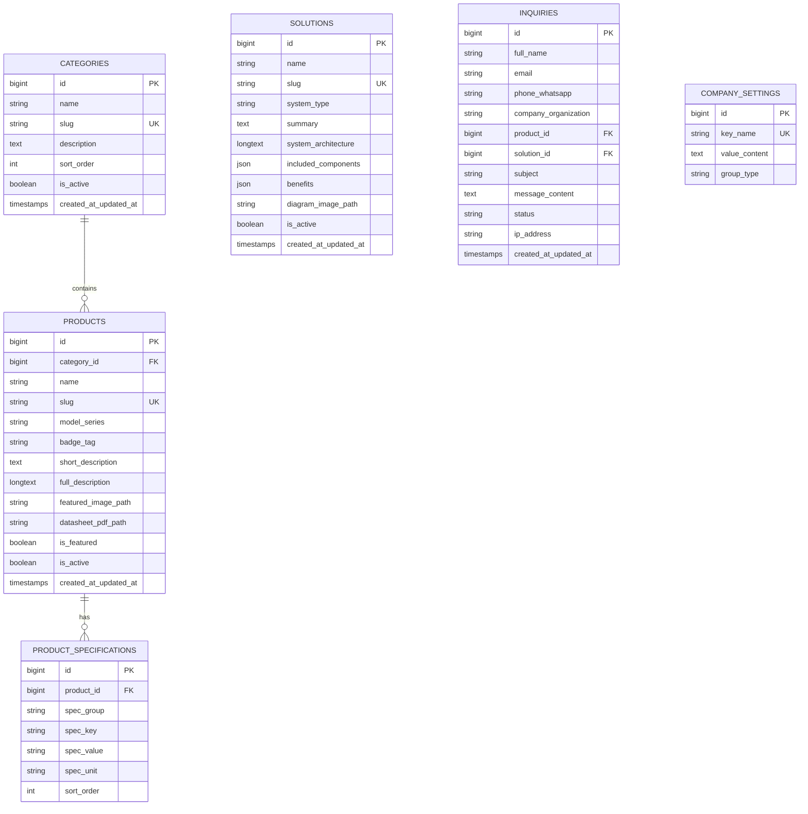

# Arsitektur Informasi & Peta Situs (IA & Sitemap)
**Dokumen:** `docs/01-ia-sitemap.md`  
**Proyek:** Revamp Website PT. Indogreen Technology And Management  
**Fase:** Fase 0 — Discovery & Audit  
**Status:** Ditetapkan sebagai Sumber Kebenaran Struktur Situs (Single Source of Truth)

---

## 1. Pendekatan & Filosofi Arsitektur Informasi

Arsitektur Informasi (Information Architecture / IA) baru dirancang untuk mentransformasikan website PT. Indogreen Technology And Management dari struktur katalog statis yang terfragmentasi menjadi sistem informasi pemasaran berstandar rekayasa (*engineering-grade marketing system*).

### Prinsip Utama IA:
1. **Semantik & Keterbacaan Mesin/Manusia:** Menghapus pola URL lama berbasis indeks numerik acak (`/produk/1/1`, `/solusi/1`) dan menggantinya dengan URL semantik berbasis slug deskriptif (`/produk/pju-tenaga-surya/pju-two-in-one-helios-series`).
2. **Segmentasi Pelanggan yang Terarah:** Mengakomodasi kebutuhan audiens B2B, kontraktor EPC, dinas pemerintah/pengadaan publik, serta pengguna residensial secara jelas.
3. **Kepatuhan Mutlak pada Design System (`docs/DESIGN.md`):** Mengadopsi sistem dua mode permukaan (kanvas hitam untuk hero/footer dan kanvas putih untuk badan halaman), tata letak navigasi primer 64px, breadcrumb bar 48px, sub-nav strip 56px, dan footer 6 kolom terstruktur.
4. **Struktur Data Terbuka & Dapat Dikelola (CMS-Ready):** Seluruh konten produk, spesifikasi, dan solusi dimodelkan agar dapat dikelola secara modular melalui Filament CMS.

---

## 2. Struktur Peta Situs (Sitemap) Baru

Hierarki URL yang ditetapkan untuk website resmi:

```text
/                                               (Beranda Utama)
├── /produk                                     (Katalog Produk EBT)
│   ├── /produk/pju-tenaga-surya                (Kategori PJU Tenaga Surya)
│   │   ├── /produk/pju-tenaga-surya/pju-two-in-one-helios-series
│   │   ├── /produk/pju-tenaga-surya/pju-two-in-one-jupiter-series
│   │   ├── /produk/pju-tenaga-surya/pju-two-in-one-mars-series
│   │   └── /produk/pju-tenaga-surya/pju-all-in-one-mars-series
│   ├── /produk/plts-residential                (Kategori PLTS Residensial / Atap)
│   │   └── /produk/plts-residential/[slug]     (TODO-CONTENT: Spesifikasi Produk Khusus)
│   ├── /produk/solar-home-system               (Kategori Solar Home System / SHS)
│   │   └── /produk/solar-home-system/[slug]    (TODO-CONTENT: Paket SHS Pedesaan/3T)
│   └── /produk/aksesoris-kelistrikan           (Kategori Aksesoris & Komponen)
│       └── /produk/aksesoris-kelistrikan/[slug] (TODO-CONTENT: Inverter/Baterai/Bracket)
├── /solusi                                     (Katalog Solusi Rekayasa EBT)
│   ├── /solusi/plts-on-grid                    (Detail Solusi PLTS On-Grid)
│   │   /solusi/plts-on-grid-hybrid             (Detail Solusi PLTS On-Grid Hybrid)
│   ├── /solusi/plts-off-grid                   (Detail Solusi PLTS Off-Grid Mandiri)
│   ├── /solusi/plts-off-grid-hybrid            (Detail Solusi PLTS Off-Grid Hybrid)
│   └── /solusi/backup-power-ups                (Detail Solusi Cadangan Daya Bebas Kedip)
├── /tentang-kami                               (Profil Perusahaan, Visi Misi, Legalitas)
├── /kontak                                     (Formulir Konsultasi, Peta Kantor, WhatsApp)
└── /kebijakan-privasi                          (Kebijakan Privasi & Syarat Ketentuan Layanan)
```

---

## 3. Rincian & Tujuan Halaman Baru

### 3.1 Beranda (`/`)
- **Peran:** Gerbang utama perusahaan yang mencerminkan kapabilitas teknik di bidang Energi Baru dan Terbarukan (EBT).
- **Komponen Utama:**
  - `hero-card-dark`: Foto/render instalasi surya berkualitas tinggi, headline utama ("Energi Bersih untuk Masa Depan Berkelanjutan"), subjudul kapabilitas, dan tombol CTA utama (`button-primary`: "Konsultasi Kebutuhan EBT").
  - `feature-card` (Grid 4 Kolom): Ringkasan 4 pilar produk utama (Lampu PJU Tenaga Surya, PLTS Residensial, Solar Home System, Aksesoris Kelistrikan).
  - Seksi Solusi Rekayasa (Grid 3 Kolom): Overview sistem On-Grid, Hybrid, dan Off-Grid.
  - `callout-stat` (Grid 3 Kolom): Data statistik kredensial perusahaan (contoh: kWp terpasang, wilayah proyek, garansi purna jual — ditandai `TODO-CONTENT` hingga verifikasi angka resmi diberikan klien).
  - `cta-strip-dark`: Ajakan bertindak ("Siap Membangun Sistem Energi Surya Anda?") yang mengarahkan ke `/kontak`.

### 3.2 Katalog Produk (`/produk`) & Halaman Kategori (`/produk/[kategori]`)
- **Peran:** Direktori teknis seluruh perangkat keras dan sistem yang disediakan.
- **Komponen Utama:**
  - `breadcrumb-bar`: Jejak navigasi (BERANDA / PRODUK).
  - `sub-nav-strip`: Filter cepat antar-kategori dengan tombol tab aktif (`pill-tab` dan `pill-tab-active`).
  - Grid `product-card` (4 kolom desktop, 2 kolom tablet, 1 kolom mobile):
    - Foto produk rasio 1:1.
    - Tag kategori (`badge-tag`).
    - Judul seri (`typography.card-title`).
    - Ringkasan teknis (lumens, daya panel, tipe baterai).
    - Tanda khas `corner-square` 12px hijau di sudut kartu.
    - Tombol aksi `button-ghost-link` ("Lihat Spesifikasi →").

### 3.3 Halaman Detail Produk (`/produk/[kategori]/[slug]`)
- **Peran:** Lembar fakta teknis (*technical datasheet view*) yang menggantikan flyer A4 lama.
- **Struktur Konten:**
  1. Header Produk: Nama seri lengkap, kategori, tag status garansi.
  2. Galeri Foto Produk: Gambar teknis multi-sudut resolusi tinggi dengan rasio 16:9 atau 1:1.
  3. Ringkasan Fitur Unggulan (`feature-card`).
  4. Tabel Spesifikasi Komprehensif: Disajikan dalam teks HTML semantik terstruktur (bukan gambar):
     - Daya Lampu / Wattage (W)
     - Fluks Cahaya / Luminous Flux (Lumen)
     - Panel Surya / Solar Photovoltaic (Jenis & Kapasitas Watt Peak)
     - Baterai Penyimpan / Battery (Kapasitas Ampere-Hour & Tipe LiFePO4)
     - Kontroler Pengisian / Controller (MPPT / PWM cerdas)
     - Waktu Pengisian & Durasi Nyala Otonom
     - Material Casing & Rating Ketahanan Cuaca (IP65 / IP66)
     - Rekomendasi Ketinggian Tiang & Jarak Antar-Tiang
  5. Tautan Unduh Datasheet Resmi (`resource-card` dengan unduhan file PDF).
  6. Tombol Permintaan Penawaran / Konsultasi Cepat via WhatsApp.

### 3.4 Katalog & Detail Solusi Rekayasa (`/solusi` & `/solusi/[slug]`)
- **Peran:** Menjelaskan sistem integrasi rekayasa PLTS bagi klien industri, komersial, maupun residensial.
- **5 Solusi Utama yang Distandardisasi:**
  1. **PLTS On-Grid (`/solusi/plts-on-grid`):** Sistem sinkronisasi jaringan PLN dengan inverter grid-tie untuk memangkas tagihan listrik harian.
  2. **PLTS On-Grid Hybrid (`/solusi/plts-on-grid-hybrid`):** Sistem hemat biaya tersambung PLN dengan proteksi baterai darurat saat pemadaman.
  3. **PLTS Off-Grid Mandiri (`/solusi/plts-off-grid`):** Sistem mandiri 100% tanpa jaringan PLN, menggunakan bank baterai untuk daerah terpencil / tanpa akses transmisi.
  4. **PLTS Off-Grid Hybrid (`/solusi/plts-off-grid-hybrid`):** Sistem off-grid yang dikombinasikan dengan sumber energi sekunder (genset / turbin angin) untuk keandalan 24/7.
  5. **Backup Power / UPS Surya (`/solusi/backup-power-ups`):** Sistem penyedia daya darurat instan tanpa jeda (*zero transfer time*) untuk fasilitas krusial.
- **Konten Per Solusi:** Diagram alir sistem arsitektur, daftar komponen yang disertakan, estimasi efisiensi energi, dan formulir kalkulator kebutuhan daya.

### 3.5 Tentang Kami (`/tentang-kami`)
- **Peran:** Membangun kredibilitas korporat PT. Indogreen Technology And Management sebagai entitas pengembang EBT legal di Indonesia.
- **Struktur Konten:**
  - Profil resmi perusahaan & sejarah pendirian.
  - Visi & Misi perusahaan di bidang transisi energi hijau Indonesia.
  - Komitmen Layanan Purna Jual (*After-Sales Oriented*).
  - Standarisasi Kualitas & Kepatuhan Legalitas.
  - Galeri Dokumentasi Proyek Pemasangan Riil.

### 3.6 Kontak & Lokasi Kantor (`/kontak`)
- **Peran:** Saluran konversi utama untuk prospek bisnis, tender, dan konsultasi teknis.
- **Struktur Konten:**
  - Formulir Konsultasi Proyek (Nama, Email, Nomor WhatsApp, Nama Perusahaan/Instansi, Kategori Kebutuhan, Pesan Teknis).
  - Tombol Direct Chat WhatsApp dengan pesan pembuka otomatis.
  - Detail Kontak Kantor Pusat (Bogor) & Kantor Perwakilan (Gandaria 8 Jakarta).
  - Peta Lokasi Interaktif / Peta Vektor Presisi.

### 3.7 Kebijakan Privasi (`/kebijakan-privasi`)
- **Peran:** Menjamin kepatuhan terhadap regulasi perlindungan data pribadi (UU PDP Indonesia No. 27 Tahun 2022).
- **Konten:** Kebijakan pengelolaan data pengguna dari formulir kontak, penggunaan cookies teknis sesi, dan hak-hak privasi pengunjung.

---

## 4. Blueprint Navigasi Global (Global Navigation)

Sesuai spesifikasi `docs/DESIGN.md`:

```text
┌────────────────────────────────────────────────────────────────────────┐
│ UTILITY BAR (H: 32px | Surface: #000000 | Text: #ffffff)               │
│ Senin - Jumat 08:30 - 17:00 WIB | support@indogreen.id | ID / EN        │
├────────────────────────────────────────────────────────────────────────┤
│ PRIMARY NAV (H: 64px | Surface: #000000 | Text: #ffffff)               │
│ [LOGO INDOGREEN]     Beranda   Produk   Solusi   Tentang Kami   Kontak │
│                                      [CTA: Hubungi Kami (#00b100)]     │
├────────────────────────────────────────────────────────────────────────┤
│ BREADCRUMB BAR (H: 48px | Surface: #f7f7f7 | Text: #1a1a1a)            │
│ BERANDA / PRODUK / PJU TENAGA SURYA / HELIOS SERIES                    │
├────────────────────────────────────────────────────────────────────────┤
│ SUB-NAV STRIP (H: 56px | Surface: #f7f7f7 | Text: #000000)             │
│ [Semua Produk]  [PJU Surya]  [PLTS Residensial]  [SHS]  [Aksesoris]    │
├────────────────────────────────────────────────────────────────────────┤
│                                                                        │
│                       KONTEN HALAMAN (CANVAS: #ffffff)                 │
│                                                                        │
├────────────────────────────────────────────────────────────────────────┤
│ FOOTER SECTION (P: 64px 48px | Surface: #000000 | Text: rgba(255..0.7))│
│ Col 1: Profil      Col 2: Produk   Col 3: Solusi  Col 4: Perusahaan    │
│ Col 5: Layanan     Col 6: Kantor Bogor & Jakarta                       │
│ ────────────────────────────────────────────────────────────────────── │
│ © 2026 PT. Indogreen Technology And Management | Kebijakan Privasi     │
└────────────────────────────────────────────────────────────────────────┘
```

---

## 5. Model Entitas Basis Data (Database Entities)

Struktur relasi data backend Laravel untuk mendukung IA di atas:



---

## 6. Otorisasi Peran & Izin Pengguna (`spatie/laravel-permission`)

Akses Filament CMS dibagi menjadi 3 tingkatan peran:

1. **`super_admin`:**
   - Hak penuh mengelola pengguna internal, peran, dan izin.
   - Mengubah konfigurasi global perusahaan (telepon, alamat kantor, email, integrasi API).
   - Melihat log aktivitas sistem dan mencadangkan data.
2. **`content_editor`:**
   - Mengelola kategori produk, entitas produk, spesifikasi teknis, dan file PDF datasheet.
   - Mengelola artikel solusi rekayasa EBT.
   - Mengunggah foto dokumentasi proyek ke pustaka media.
3. **`sales_officer`:**
   - Membaca dan menindaklanjuti data permintaan penawaran/konsultasi (`inquiries`) dari formulir kontak.
   - Mengubah status prospek (*Pending*, *Contacted*, *Quoted*, *Archived*).
   - Menambahkan catatan internal pada setiap prospek.

---

## 7. Rekapitulasi Keputusan Arsitektur

- **Stack Resmi:** Laravel 11/12 (API JSON + Filament CMS), MySQL 8.0, SvelteKit (Svelte 5 SSR) + Tailwind CSS.
- **Ikon:** Lucide Icons (utama) & Font Awesome 6 Free (fallback).
- **Infrastruktur:** Server Ubuntu 24.04 LTS tanpa Docker, web server Nginx, PHP-FPM 8.4, Node 24 systemd service, queue worker systemd.
- **Lingkungan Saat Ini:** Lingkungan lokal tanpa CAPTCHA, tanpa domain publik, dan tanpa staging terpisah.
