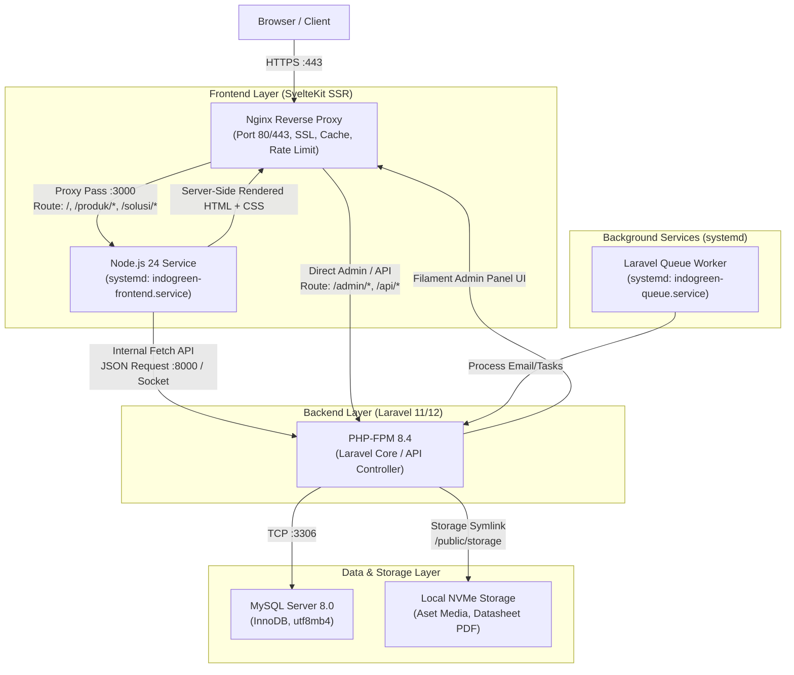

# Arsitektur Sistem & Infrastruktur
**Dokumen:** `docs/02-architecture.md`  
**Proyek:** Revamp Website PT. Indogreen Technology And Management  
**Fase:** Fase 1 — Fondasi Monorepo & Dokumen Arsitektur  
**Status:** Ditetapkan sebagai Pedoman Arsitektur Teknis

---

## 1. Gambaran Umum Arsitektur

Website resmi PT. Indogreen Technology And Management dibangun menggunakan pendekatan **Monorepo Decoupled Architecture**:
- **Frontend:** SvelteKit (Svelte 5 Runes) dengan Server-Side Rendering (SSR) untuk menjamin kecepatan muat, kepatuhan Core Web Vitals, dan visibilitas SEO maksimal.
- **Backend:** Laravel 11/12 yang beroperasi murni sebagai penyedia REST API JSON untuk publik dan panel CMS administratif berbasis Filament v3.
- **Infrastruktur:** Sistem berjalan langsung (*bare-metal*) di atas sistem operasi **Ubuntu 24.04 LTS TANPA DOCKER**, dimediasi oleh Nginx sebagai web server utama dan reverse proxy.

---

## 2. Diagram Alir Permintaan (Request Lifecycle)



---

## 3. Pembagian Tanggung Jawab (Separation of Concerns)

| Komponen | Peran & Tanggung Jawab Utama | Batasan & Aturan |
|---|---|---|
| **Nginx Web Server** | - Terminasi SSL/TLS (HTTPS) & HSTS.<br>- Reverse proxy ke SvelteKit Node service (`127.0.0.1:3000`).<br>- Reverse proxy / FastCGI pass ke Laravel PHP-FPM (`unix:/run/php/php8.4-fpm.sock`).<br>- Pengiriman langsung aset statis publik (`/static`, `/storage`).<br>- Gzip/Brotli compression & HTTP Security Headers. | Dilarang memproses logika bisnis; hanya menangani lalu lintas jaringan dan routing gateway. |
| **SvelteKit (Frontend)** | - Server-Side Rendering (SSR) halaman publik untuk SEO.<br>- Implementasi sistem desain resmi `docs/DESIGN.md` (Green `#00b100`, Inter, 2px radius).<br>- Pengambilan data dari Laravel API melalui server load functions.<br>- Validasi formulir interaktif di sisi klien (kontak & konsultasi). | Tidak mengakses basis data secara langsung; seluruh data diperoleh via Laravel JSON API. |
| **Laravel API (Backend)** | - Penyedia RESTful JSON API publik terproteksi sanitasi.<br>- Panel administrasi konten via Filament CMS v3.<br>- Manajemen peran dan izin via `spatie/laravel-permission`.<br>- Pemrosesan antrean tugas latar belakang (*Queue Worker*).<br>- Validasi data tingkat akhir dan pengiriman notifikasi email. | Tidak merender Blade template untuk tampilan publik; Blade hanya digunakan untuk Filament CMS admin. |
| **MySQL 8.0** | - Penyimpanan relasional terstruktur (ACID compliant).<br>- Indeks pencarian produk, kategori, solusi, dan penawaran.<br>- Integritas data referensial (Foreign Keys & Constraints). | Hanya dapat diakses dari `127.0.0.1` (dilarang membuka akses publik remote MySQL). |

---

## 4. Strategi Caching

1. **Aset Statis (Static Asset Caching):**
   - Berkas build SvelteKit (`/_app/immutable/*`) disetel dengan header `Cache-Control: public, max-age=31536000, immutable`.
   - Berkas media publik (`/storage/*`) disetel dengan `Cache-Control: public, max-age=2592000` (30 hari).
2. **SvelteKit SSR Caching:**
   - Halaman publik yang jarang berubah (katalog produk, solusi, tentang kami) menggunakan strategi `Cache-Control: s-maxage=600, stale-while-revalidate=86400` di tingkat Nginx/Edge.
3. **Backend Query Caching:**
   - Data konfigurasi perusahaan (`company_settings`) dan daftar kategori disimpan di dalam Laravel Cache driver untuk meminimalkan beban baca basis data. Cache otomatis dibersihkan saat admin melakukan pembaruan di Filament CMS.

---

## 5. Strategi Penanganan Error (Error Handling & Resilience)

1. **Format Respons Error API Terstandarisasi:**
   Seluruh kegagalan API Laravel mengembalikan struktur JSON konsisten:
   ```json
   {
     "success": false,
     "message": "Pesan deskripsi kesalahan berbahasa Indonesia",
     "error_code": "RESOURCE_NOT_FOUND",
     "errors": {}
   }
   ```
2. **Error Validasi Form (HTTP 422 Unprocessable Entity):**
   ```json
   {
     "success": false,
     "message": "Data yang dikirimkan tidak valid.",
     "error_code": "VALIDATION_ERROR",
     "errors": {
       "email": ["Format email tidak valid."],
       "phone_whatsapp": ["Nomor WhatsApp wajib diisi."]
     }
   }
   ```
3. **Frontend Error Boundaries:**
   - SvelteKit mengimplementasikan `+error.svelte` khusus yang mengikuti sistem desain `docs/DESIGN.md` untuk menampilkan pesan kesalahan 404 (Halaman Tidak Ditemukan) dan 500 (Gangguan Server) secara profesional tanpa mengekspos jejak teknis (*stack trace*) ke publik.

---

## 6. Keamanan & Pengerasan Sistem (Security Hardening)

1. **HTTP Security Headers di Tingkat Nginx:**
   ```nginx
   add_header X-Frame-Options "SAMEORIGIN" always;
   add_header X-Content-Type-Options "nosniff" always;
   add_header Referrer-Policy "strict-origin-when-cross-origin" always;
   add_header Strict-Transport-Security "max-age=31536000; includeSubDomains" always;
   add_header Content-Security-Policy "default-src 'self'; script-src 'self' 'unsafe-inline'; style-src 'self' 'unsafe-inline' https://fonts.googleapis.com; font-src 'self' https://fonts.gstatic.com data:; img-src 'self' data: https:; connect-src 'self';" always;
   ```
2. **Proteksi Anti-Spam Formulir Publik (Tanpa CAPTCHA):**
   - **Honeypot:** Penambahan field tersembunyi `website_url` yang tidak boleh diisi manusia. Jika terisi oleh bot otomatis, request langsung ditolak dengan kode 200 palsu atau 422.
   - **Throttling:** Pembatasan frekuensi pengiriman formulir kontak maksimal 5 request per 10 menit per IP address via middleware Laravel.
3. **Penyembunyian Jejak Server:**
   - Menonaktifkan header `server_tokens off;` di Nginx.
   - Menonaktifkan header `expose_php = Off` di berkas `php.ini`.

---

## 7. Keputusan Arsitektur & Justifikasi Teknis

1. **Filament CMS v3:**
   - *Alasan:* Filament dibangun di atas TALL stack (Tailwind, Alpine, Laravel, Livewire) yang terintegrasi secara native dengan model Eloquent Laravel. Memungkinkan pembuatan panel administrasi yang aman, cepat, dan modern tanpa perlu membangun aplikasi dashboard terpisah dari nol.
2. **Spatie Laravel Permission (`spatie/laravel-permission`):**
   - *Alasan:* Standar industri untuk otorisasi Laravel. Menggunakan tabel relasi terpisah (`roles`, `permissions`, `model_has_roles`) sehingga tabel `users` tetap bersih tanpa kolom role statis yang kaku.
3. **MySQL Server 8.0:**
   - *Alasan:* Menyediakan dukungan fungsi JSON native performa tinggi, Common Table Expressions (CTE), dan integritas transaksional yang matang untuk data katalog teknik dan penawaran.
4. **Deploy Tanpa Docker:**
   - *Alasan:* Menghilangkan overhead virtualisasi kontainer pada server Ubuntu 24.04. Seluruh proses dikelola langsung oleh init system bawaan Linux (`systemd`), menghasilkan konsumsi RAM yang jauh lebih hemat (< 1 GB) dan latensi I/O disk yang optimal.

---

## 8. Panduan Pengembangan Lokal (Local Development)

### 8.1 Prasyarat Perangkat Lunak
- **Sistem Operasi:** macOS / Ubuntu 24.04 Linux
- **PHP:** `^8.4` (Ekstensi wajib: `pdo_mysql`, `mbstring`, `openssl`, `curl`, `xml`, `zip`, `intl`)
- **Composer:** `^2.8`
- **Node.js:** `^24.0.0` (LTS) & NPM `^10.0.0` (Gunakan `.nvmrc`)
- **Basis Data:** MySQL Server 8.0 terpasang lokal (*native*)

> [!WARNING]
> **Status Mesin Host Saat Ini:**  
> Pada mesin host saat ini, server MySQL 8.0 belum terpasang (hanya terdeteksi program klien MariaDB 10.4). Sebelum menjalankan backend, pasang server MySQL 8.0 native terlebih dahulu:
> - **Ubuntu 24.04:** `sudo apt update && sudo apt install mysql-server -y`
> - **macOS (Homebrew):** `brew install mysql && brew services start mysql`

### 8.2 Konfigurasi Database Lokal
Jalankan perintah SQL berikut di terminal MySQL (`mysql -u root -p`):
```sql
CREATE DATABASE indogreen_db CHARACTER SET utf8mb4 COLLATE utf8mb4_unicode_ci;
CREATE USER 'indogreen_user'@'localhost' IDENTIFIED BY 'indogreen_secret123';
GRANT ALL PRIVILEGES ON indogreen_db.* TO 'indogreen_user'@'localhost';
FLUSH PRIVILEGES;
```

### 8.3 Alokasi Port Lokal
- **Frontend SvelteKit (Dev SSR):** `http://localhost:3000`
- **Backend Laravel API & Filament:** `http://localhost:8000`
- **MySQL Database Server:** `127.0.0.1:3306`
- **Mailpit Web UI (Opsional Mail Testing):** `http://localhost:8025` (SMTP port `1025`)

### 8.4 Penanganan Pengiriman Email di Lokal
Untuk pengujian formulir kontak di lingkungan lokal tanpa koneksi SMTP publik:
- **Pilihan 1 (Default):** Setel `MAIL_MAILER=log` pada `backend/.env`. Seluruh isi email notifikasi akan dicatat ke berkas log `backend/storage/logs/laravel.log`.
- **Pilihan 2 (Mailpit Biner Standalone):** Unduh biner Mailpit tanpa Docker:
  ```bash
  # Menjalankan mailpit lokal
  mailpit
  ```
  Lalu setel `MAIL_MAILER=smtp`, `MAIL_HOST=127.0.0.1`, `MAIL_PORT=1025` pada `backend/.env`.

---

## 9. Ringkasan Deployment Server (Merujuk ke Fase 12)

Pada tahap produksi di server Ubuntu 24.04:
1. **Nginx:** Dikonfigurasi dengan file `deploy/nginx/indogreen.conf` yang mengarahkan root domain ke socket PHP-FPM dan proxy ke port Node 3000.
2. **Node.js SvelteKit:** Dikelola oleh unit systemd `deploy/systemd/indogreen-frontend.service`.
3. **Queue Worker Laravel:** Dikelola oleh unit systemd `deploy/systemd/indogreen-queue.service`.
4. **Skrip Otomasi Deployment:** Berkas `deploy/deploy.sh` akan mengeksekusi git pull, composer install, artisan migrate, npm build, dan reload service systemd secara atomik.
