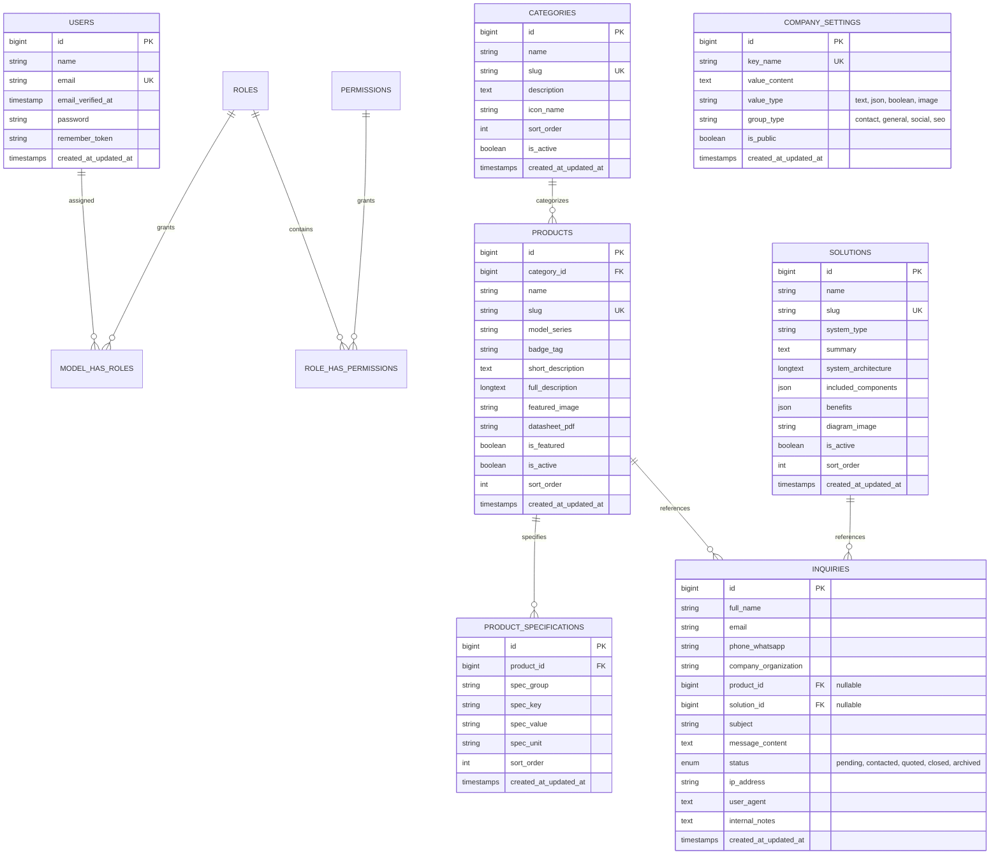

# Model Data & Skema Basis Data (Data Model)
**Dokumen:** `docs/03-data-model.md`  
**Proyek:** Revamp Website PT. Indogreen Technology And Management  
**Fase:** Fase 1 — Fondasi Monorepo & Dokumen Arsitektur  
**Status:** Draf Spesifikasi Skema Basis Data MySQL 8.0

---

## 1. Prinsip Desain Skema Basis Data

1. **Integritas Relasional & Performa:**
   - Menggunakan engine **InnoDB** dengan karakter set `utf8mb4` dan collation `utf8mb4_unicode_ci`.
   - Menggunakan tipe kunci utama `BIGINT UNSIGNED AUTO_INCREMENT` (atau UUID jika diperlukan audit terdistribusi).
   - Seluruh relasi kunci asing (*Foreign Keys*) memiliki aturan `ON DELETE CASCADE` atau `ON DELETE SET NULL` yang eksplisit.
2. **Otorisasi Tanpa Kolom `role`:**
   - Tabel `users` **TIDAK MEMILIKI** kolom `role` atau `is_admin`.
   - Seluruh manajemen peran, izin, dan hak akses dikelola murni oleh paket standar `spatie/laravel-permission` melalui tabel perantara polimorfik.
3. **Standarisasi Slug Unik (Unique Slug Rule):**
   - Kolom `slug` pada tabel `categories`, `products`, dan `solutions` wajib bersifat `UNIQUE`.
   - Nilai slug dibatasi hanya huruf kecil alfanumerik dan tanda hubung (`^[a-z0-9]+(?:-[a-z0-9]+)*$`).
   - Dijamin otomatis oleh Eloquent Observer (*auto-slugifier*) saat pembuatan entitas.
4. **Transformasi Spesifikasi Gambar ke Data Terstruktur:**
   - Data spesifikasi teknis produk PJU disimpan dalam tabel relasional `product_specifications`, bukan teks JSON mentah tak terindeks atau gambar flyer.

---

## 2. Diagram Relasi Entitas (ERD)

---

## 3. Rincian Skema Tabel Basis Data

### 3.1 Tabel `users`
Tabel akun pengguna internal (Admin CMS dan Staf Teknis). **Tidak memuat kolom role.**

| Kolom | Tipe Data | Keterangan / Atribut |
|---|---|---|
| `id` | `BIGINT UNSIGNED` | Primary Key, Auto Increment |
| `name` | `VARCHAR(255)` | Nama lengkap staf pengguna |
| `email` | `VARCHAR(255)` | Alamat email resmi, **Unique Index** |
| `email_verified_at` | `TIMESTAMP NULL` | Tanggal verifikasi email |
| `password` | `VARCHAR(255)` | Hash kata sandi (Bcrypt / Argon2id) |
| `remember_token` | `VARCHAR(100) NULL` | Token sesi remember-me Laravel |
| `created_at` / `updated_at`| `TIMESTAMP NULL` | Waktu pembuatan & modifikasi |

---

### 3.2 Tabel `categories`
Kategori produk utama EBT (PJU Surya, PLTS Residensial, SHS, Aksesoris Kelistrikan).

| Kolom | Tipe Data | Keterangan / Atribut |
|---|---|---|
| `id` | `BIGINT UNSIGNED` | Primary Key, Auto Increment |
| `name` | `VARCHAR(255)` | Nama kategori (misal: "PJU Tenaga Surya") |
| `slug` | `VARCHAR(255)` | Slug URL unik, **Unique Index** |
| `description` | `TEXT NULL` | Deskripsi umum kategori produk |
| `icon_name` | `VARCHAR(100) NULL` | Nama ikon (Lucide icon identifier) |
| `sort_order` | `INT DEFAULT 0` | Urutan penayangan di navigasi & katalog |
| `is_active` | `BOOLEAN DEFAULT 1`| Status aktif penayangan publik |
| `created_at` / `updated_at`| `TIMESTAMP NULL` | Timestamps Laravel |

---

### 3.3 Tabel `products`
Katalog induk seluruh produk perangkat keras dan luminer.

| Kolom | Tipe Data | Keterangan / Atribut |
|---|---|---|
| `id` | `BIGINT UNSIGNED` | Primary Key, Auto Increment |
| `category_id` | `BIGINT UNSIGNED` | Foreign Key ke `categories.id` (`ON DELETE RESTRICT`) |
| `name` | `VARCHAR(255)` | Nama resmi produk (misal: "PJU Two-In-One Helios Series") |
| `slug` | `VARCHAR(255)` | Slug URL unik, **Unique Index** |
| `model_series` | `VARCHAR(100)` | Kode seri produk (misal: "TIO-HELIOS") |
| `badge_tag` | `VARCHAR(50) NULL` | Tag label kartu (misal: "POPULAR", "NEW", "TIO") |
| `short_description` | `TEXT` | Ringkasan teknis untuk kartu produk (maks 200 karakter) |
| `full_description` | `LONGTEXT NULL` | Penjelasan komprehensif, fitur, dan aplikasi lapangan |
| `featured_image` | `VARCHAR(255) NULL`| Jalur berkas gambar utama rasio 1:1 di storage lokal |
| `datasheet_pdf` | `VARCHAR(255) NULL` | Jalur berkas PDF lembar spesifikasi resmi untuk diunduh |
| `is_featured` | `BOOLEAN DEFAULT 0`| Tampilkan di seksi unggulan beranda |
| `is_active` | `BOOLEAN DEFAULT 1`| Status aktif penayangan publik |
| `sort_order` | `INT DEFAULT 0` | Urutan penayangan dalam katalog |
| `created_at` / `updated_at`| `TIMESTAMP NULL` | Timestamps Laravel |

**Index Khusus:**
- `INDEX idx_products_category_active (category_id, is_active, sort_order)`
- `INDEX idx_products_featured (is_featured, is_active)`

---

### 3.4 Tabel `product_specifications`
Tabel rincian parameter teknis individual yang mentransformasikan data flyer A4 lama ke format terstruktur.

| Kolom | Tipe Data | Keterangan / Atribut |
|---|---|---|
| `id` | `BIGINT UNSIGNED` | Primary Key, Auto Increment |
| `product_id` | `BIGINT UNSIGNED` | Foreign Key ke `products.id` (`ON DELETE CASCADE`) |
| `spec_group` | `VARCHAR(100)` | Kelompok parameter (misal: "Elektrikal", "Baterai", "Mekanikal") |
| `spec_key` | `VARCHAR(100)` | Nama parameter (misal: "Luminous Flux", "Battery Type") |
| `spec_value` | `VARCHAR(255)` | Nilai spesifikasi (misal: "180", "LiFePO4 12.8V 60Ah") |
| `spec_unit` | `VARCHAR(50) NULL` | Satuan pengukuran (misal: "lm/W", "Wp", "Ah", "IP66") |
| `sort_order` | `INT DEFAULT 0` | Urutan baris dalam tabel spesifikasi |
| `created_at` / `updated_at`| `TIMESTAMP NULL` | Timestamps Laravel |

**Index Khusus:**
- `INDEX idx_specs_product_group (product_id, spec_group, sort_order)`

---

### 3.5 Tabel `solutions`
Katalog 5 solusi rekayasa integrasi PLTS PT. Indogreen.

| Kolom | Tipe Data | Keterangan / Atribut |
|---|---|---|
| `id` | `BIGINT UNSIGNED` | Primary Key, Auto Increment |
| `name` | `VARCHAR(255)` | Nama solusi (misal: "PLTS On-Grid System") |
| `slug` | `VARCHAR(255)` | Slug URL unik, **Unique Index** |
| `system_type` | `VARCHAR(100)` | Klasifikasi sistem ("On-Grid", "Hybrid", "Off-Grid", "UPS") |
| `summary` | `TEXT` | Ringkasan eksekutif manfaat solusi |
| `system_architecture` | `LONGTEXT` | Penjelasan skema kerja dan alur kelistrikan |
| `included_components` | `JSON` | Daftar komponen utama yang disertakan (Array string/objek) |
| `benefits` | `JSON` | Daftar poin keunggulan ekonomi & teknis |
| `diagram_image` | `VARCHAR(255) NULL`| Jalur ilustrasi diagram sistem (SVG/WebP) di storage |
| `is_active` | `BOOLEAN DEFAULT 1`| Status aktif penayangan publik |
| `sort_order` | `INT DEFAULT 0` | Urutan penayangan |
| `created_at` / `updated_at`| `TIMESTAMP NULL` | Timestamps Laravel |

---

### 3.6 Tabel `inquiries`
Penyimpanan data prospek, permohonan konsultasi teknis, dan permintaan penawaran dari formulir web.

| Kolom | Tipe Data | Keterangan / Atribut |
|---|---|---|
| `id` | `BIGINT UNSIGNED` | Primary Key, Auto Increment |
| `full_name` | `VARCHAR(255)` | Nama lengkap calon klien / narahubung |
| `email` | `VARCHAR(255)` | Alamat email calon klien |
| `phone_whatsapp` | `VARCHAR(50)` | Nomor kontak telepon / WhatsApp |
| `company_organization`| `VARCHAR(255) NULL`| Nama perusahaan, instansi dinas, atau instansi tender |
| `product_id` | `BIGINT UNSIGNED NULL` | Referensi produk terkait (`ON DELETE SET NULL`) |
| `solution_id` | `BIGINT UNSIGNED NULL`| Referensi solusi terkait (`ON DELETE SET NULL`) |
| `subject` | `VARCHAR(255)` | Subjek konsultasi / permohonan penawaran |
| `message_content` | `TEXT` | Uraian kebutuhan teknis dan pesan calon klien |
| `status` | `ENUM(...)` | Status prospek: `'pending'`, `'contacted'`, `'quoted'`, `'closed'`, `'archived'` (Default: `'pending'`) |
| `ip_address` | `VARCHAR(45) NULL` | Alamat IP pengirim (untuk audit & anti-spam) |
| `user_agent` | `TEXT NULL` | Header peramban pengirim |
| `internal_notes` | `TEXT NULL` | Catatan internal tim sales di Filament CMS |
| `created_at` / `updated_at`| `TIMESTAMP NULL` | Timestamps Laravel |

**Index Khusus:**
- `INDEX idx_inquiries_status_date (status, created_at)`

---

### 3.7 Tabel `company_settings`
Konfigurasi profil korporat fleksibel berbasis pasangan kunci-nilai (*key-value*).

| Kolom | Tipe Data | Keterangan / Atribut |
|---|---|---|
| `id` | `BIGINT UNSIGNED` | Primary Key, Auto Increment |
| `key_name` | `VARCHAR(100)` | Kunci unik konfigurasi, **Unique Index** |
| `value_content` | `LONGTEXT NULL` | Isi data nilai (teks, nomor telp, JSON koordinat) |
| `value_type` | `VARCHAR(50)` | Tipe parsing: `'text'`, `'json'`, `'boolean'`, `'image'` |
| `group_type` | `VARCHAR(50)` | Kelompok pengaturan: `'contact'`, `'general'`, `'social'`, `'stats'` |
| `is_public` | `BOOLEAN DEFAULT 1`| Apakah dapat diakses oleh publik via API |
| `created_at` / `updated_at`| `TIMESTAMP NULL` | Timestamps Laravel |

---

### 3.8 Tabel-Tabel Otorisasi Spatie (`spatie/laravel-permission`)
Dihasilkan otomatis melalui migrasi bawaan Spatie:
- `roles` (`id`, `name`, `guard_name`, `created_at`, `updated_at`)
- `permissions` (`id`, `name`, `guard_name`, `created_at`, `updated_at`)
- `model_has_roles` (`role_id`, `model_type`, `model_id`)
- `model_has_permissions` (`permission_id`, `model_type`, `model_id`)
- `role_has_permissions` (`permission_id`, `role_id`)

#### Matriks Peran & Izin Default (Role-Permission Matrix)
Berikut adalah matriks peran dan izin baku yang diterapkan pada `RolePermissionSeeder` dan dapat disesuaikan:

| Izin (Permission) | Deskripsi Hak Akses | Peran `admin` | Peran `editor` |
|---|---|:---:|:---:|
| `access-admin` | Mengakses dashboard administratif panel CMS | ✅ | ✅ |
| `content.manage` | Membuat, mengedit, menghapus kategori, produk, solusi, & spesifikasi | ✅ | ✅ |
| `settings.manage` | Memperbarui profil perusahaan & konfigurasi situs (`company_settings`) | ✅ | ❌ |
| `inquiries.view` | Melihat data kontak prospek dan formulir penawaran masuk | ✅ | ✅ |
| `inquiries.update` | Memperbarui status prospek dan catatan internal sales | ✅ | ✅ |
| `inquiries.delete` | Menghapus permanen atau mengarsipkan inquiry | ✅ | ❌ |
| `users.manage` | Mengelola akun pengguna internal staf | ✅ | ❌ |
| `roles.manage` | Mengatur hak akses peran dan izin Spatie | ✅ | ❌ |

---

### 3.9 Konfigurasi Spatie Media Library & Konversi WebP
Seluruh aset media dikaitkan ke model Eloquent via `spatie/laravel-medialibrary` dengan koleksi terdaftar:

| Koleksi Media | Model Pemilik | Batasan MIME Type | Konversi Otomatis (WebP) | Custom Property |
|---|---|---|---|---|
| `category_image` | `Category` | `image/jpeg`, `image/png`, `image/webp` | `thumb` (200×200), `card` (600×600), `hero` (1920×1080) | `alt` (Alt text aksesibilitas) |
| `product_gallery` | `Product` | `image/jpeg`, `image/png`, `image/webp` | `thumb` (200×200), `card` (600×600), `hero` (1920×1080) | `alt` (Alt text aksesibilitas) |
| `product_datasheet` | `Product` | `application/pdf` | Tanpa konversi raster (berkas unduhan murni) | `title`, `description` |
| `solution_image` | `Solution` | `image/jpeg`, `image/png`, `image/webp`, `image/svg+xml` | `thumb` (200×200), `card` (600×600), `hero` (1920×1080) | `alt` (Alt text aksesibilitas) |
| `hero_desktop` | `Product`, `Solution`, `CompanySetting` | `image/jpeg`, `image/png`, `image/webp` | `thumb` (200×200), `card` (600×600), `hero` (1920×1080) | `alt` (Alt text aksesibilitas) |
| `hero_mobile` | `Product`, `Solution`, `CompanySetting` | `image/jpeg`, `image/png`, `image/webp` | `thumb` (200×200), `card` (600×600), `hero` (1920×1080) | `alt` (Alt text aksesibilitas) |

---

### 3.10 Enum PHP yang Digunakan
1. **`App\Enums\InquiryStatus`**:
   - Nilai: `'pending'` (Menunggu Ditinjau), `'contacted'` (Sudah Dihubungi), `'quoted'` (Penawaran Terkirim), `'closed'` (Selesai), `'archived'` (Diarsipkan).
2. **`App\Enums\OfficeType`**:
   - Nilai: `'head_office'` (Kantor Utama), `'representative_office'` (Kantor Perwakilan).

---

## 4. Rencana Seeder Awal (Initial Seeding Strategy)

1. **`RolePermissionSeeder`:**
   - Idempotent dan mereset cache permission (`forgetCachedPermissions`).
   - Membuat 8 izin resmi dan 2 peran inti (`admin` dan `editor`) sesuai matriks otorisasi.
2. **`AdminUserSeeder`:**
   - Mengambil kredensial dari environment (`ADMIN_NAME`, `ADMIN_EMAIL`, `ADMIN_PASSWORD`).
   - Menetapkan peran `admin` secara otomatis pada akun yang dibuat/diperbarui.
3. **`CategorySeeder`:**
   - Menginisialisasi 4 kategori resmi: `pju-tenaga-surya`, `plts-residential`, `solar-home-system`, `aksesoris-kelistrikan`.
4. **`ProductSeeder`:**
   - Memasukkan 4 seri produk riil eksisting: `pju-two-in-one-helios-series`, `pju-two-in-one-jupiter-series`, `pju-two-in-one-mars-series`, `pju-all-in-one-mars-series`.
   - Menyertakan data spesifikasi teknis awal ke dalam `product_specifications`.
5. **`SolutionSeeder`:**
   - Menginisialisasi 5 solusi EBT: `plts-on-grid`, `plts-on-grid-hybrid`, `plts-off-grid`, `plts-off-grid-hybrid`, `backup-power-ups`.
6. **`CompanySettingSeeder`:**
   - Memasukkan data terverifikasi (Telepon Bogor, Email `support@indogreen.id`, Alamat Bogor & Gandaria 8) serta penanda `TODO-CONTENT` untuk aset yang belum disahkan.
